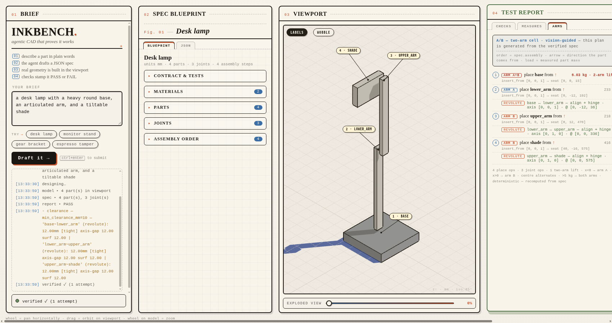
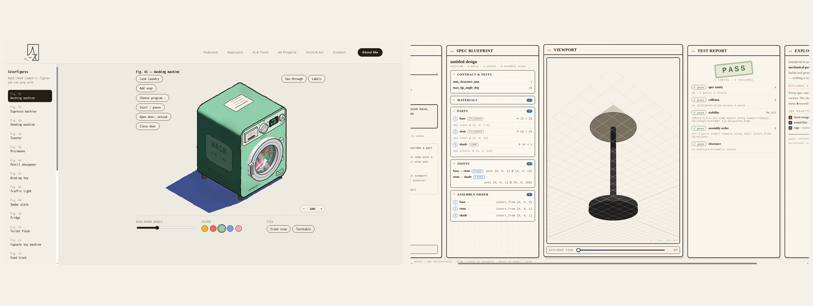
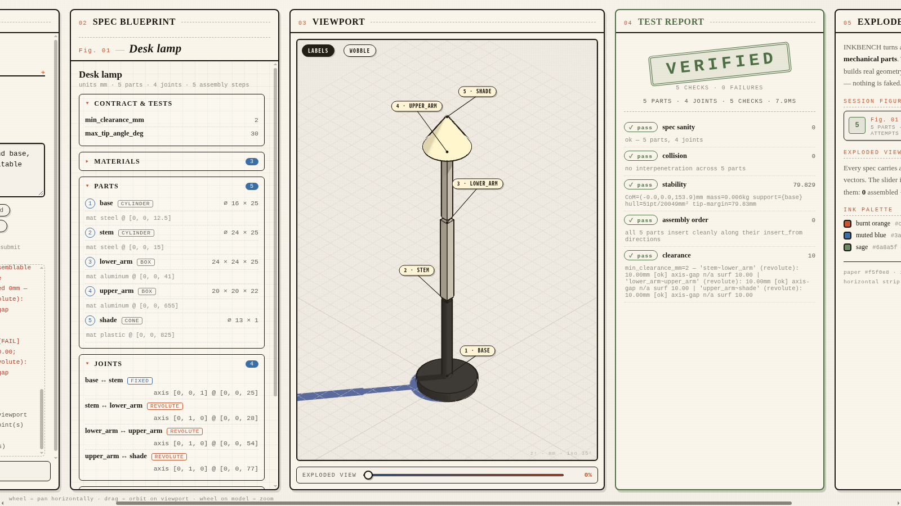

# Inkbench — agentic CAD that proves it works



Describe a part in plain words. An agent (Meta **muse-spark-1.3** via the Meta Model API)
drafts a parametric spec. The bench builds real geometry in a hand-inked isometric
viewport, then runs **real geometric verification** — nothing is faked or pre-baked:

| check | what it actually does |
|---|---|
| spec sanity | duplicate ids, degenerate dims, dangling joints |
| collision | triangle-level interpenetration (Möller–Trumbore) per AABB-overlapping pair; `fixed` joints may touch |
| stability | mass-weighted mesh centroid → CoM projected against the convex hull of the ground-support footprint; reports real tip margin (mm) and mass (kg) |
| assembly order | swept-AABB simulation along each part's `insert_from` direction — detects "can't reach its seat" blockers |
| clearance | raycast gap along revolute/prismatic joint axes vs `tests.min_clearance_mm` |

If a check fails, the failure text is fed back to the agent, which redesigns —
up to 3 attempts. The whole loop is live in the UI's agent log.

Demo recording (a real fail → redesign → verified run, ~2 min):
[`research/demo_clip.mp4`](research/demo_clip.mp4)

## Run

```bash
npm install        # three.js only
cp .env.example .env   # add your Meta Model API key (LLM_API_KEY=...)
npm run dev        # http://localhost:4173  (PORT=<n> to change)
```

Design language comparison vs. the Colorfigures reference (left) and mainstream
AI-CAD sites: `research/COMPARE.md` — rendered evidence in `docs/compare.png`.



## Layout

The page never scrolls vertically — it's a horizontal strip of full-height
cards (wheel pans horizontally; cards scroll internally):

`01 BRIEF → 02 SPEC BLUEPRINT → 03 VIEWPORT → 04 TEST REPORT → 05 EXPLODED/ABOUT`



Design language borrowed from Colorfigures (hand-inked isometric, cream paper,
indigo cast shadows, numbered figures) — see `research/DESIGN.md`.

## Stack

three.js r180 · no build step (ES modules + import map) · node server doubles as
static file server + `/api/chat` proxy so the API key never touches the client.

## The pipeline — and where the arms come in

```
brief ──► muse-spark spec ──► geometry ──► verification ──► BUILD PLAN ──► two-arm cell
                ▲                    └──── fail feedback ────┘            (OpenCV + vision model
                                                                           drives the arms)
```

The verification engine emits a real **build plan** (Report → Arms tab): ordered
insertion steps, per-arm assignments, press/weld vs align operations per joint
type, and per-part masses with two-arm lift flags. That's the program a
vision-guided robot cell executes — the same loop that fixed the lamp spec here
is the loop that would re-plan an arm's next move. `research/REFS.md` has the
reference clips (two-arm assembly planning; hand-inked figures).

Meta Global AI Developer Hackathon 2026 — Indie Developer track.
